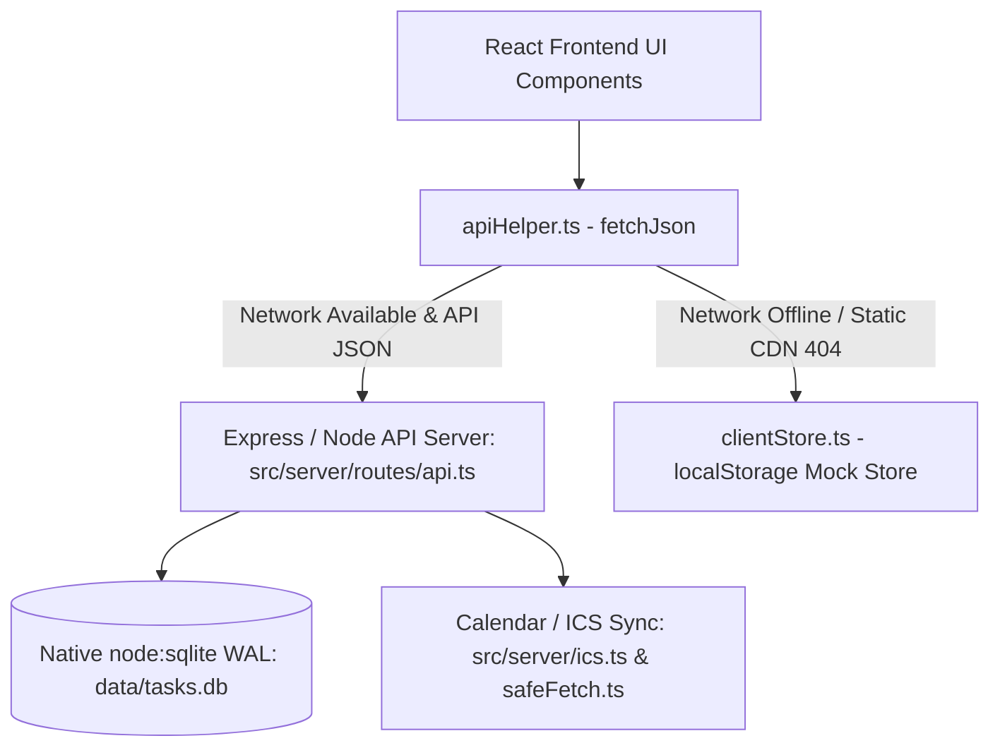
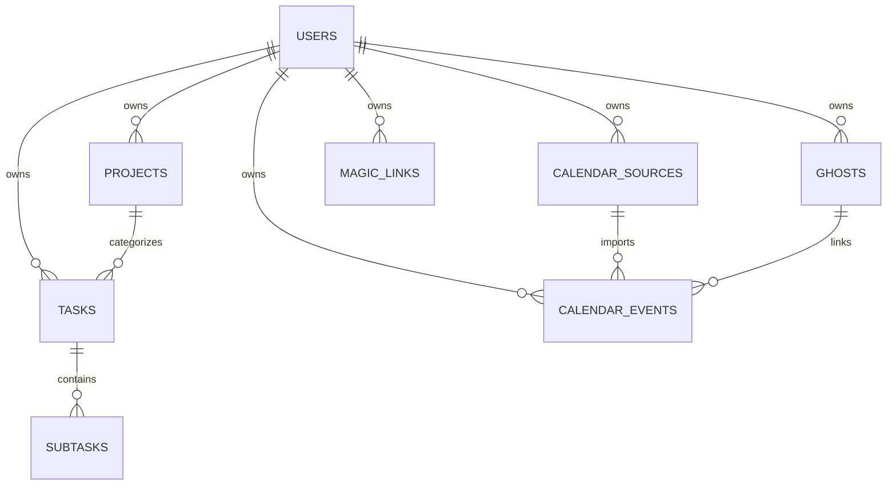

# Cadence (HabitCorp) — Codebase Architecture & System Manual

> **Purpose of this Document:**  
> This document serves as the authoritative, rapid-lookup architectural map of the Cadence codebase.  
> When modifying features, fixing bugs, or adding endpoints, consult this guide to instantly pinpoint the exact files, line numbers, data contracts, and failure modes involved without spending time searching.

---

## 🗺️ System Overview & Dual-Mode Runtime

Cadence operates in a **Dual-Mode Architecture**:
1. **Full-Stack Mode (Default)**: Vite React frontend communicating via REST (`/api/v1/*`) to Node.js backend with native SQLite (`node:sqlite` in WAL mode).
2. **Local-First Fallback Mode**: When deployed to static CDNs or running offline without Node.js backend, [`apiHelper.ts`](../src/client/apiHelper.ts) automatically falls back to in-browser storage powered by [`clientStore.ts`](../src/client/clientStore.ts).

---

## 📁 File Structure & Responsibilities Directory

### 🖥️ Client-Side (`src/client/`)

| File Path | Description & Responsibilities | Key Functions / State |
| :--- | :--- | :--- |
| [`App.tsx`](../src/client/App.tsx) | **Master Application Shell & Board Coordinator**. Manages top-level auth, project filtering, energy filtering, task lists (To-Dos, Habits, Dailies), overdue reset banners, Pomodoro timer integration, view switcher, and modal triggers. | `tasks`, `meetings`, `projects`, `ghosts`, `handleScoreTask`, `handleSaveTask`, `handleDeleteTask`, `handleQuickScheduleTodayToAgenda`, `handleDeleteProject` |
| [`components/AgendaView.tsx`](../src/client/components/AgendaView.tsx) | **Day & Week Time-Blocked Agenda Grid**. Renders 24-hour drag-and-drop slots, meeting blocks, ghost calendar indicators, 15m transition buffers, and unscheduled task side-drawers. | `viewMode` (`day` vs `week`), `getWeekDays()`, `doesMeetingOccurOnDate()`, `handleDrop`, `onUnscheduleTask` |
| [`components/TaskModal.tsx`](../src/client/components/TaskModal.tsx) | **Task / Habit / Daily Creation & Edit Modal**. Configures difficulty (Trivial/Easy/Medium/Hard), project assignment, time of day, due dates, agenda time blocks, checklist subtasks, and safe 2-step deletion. | `kind` (`habit` vs `task`), `difficulty`, `timeOfDay`, `subtasks`, `handleDelete`, `onSave`, `onDelete` |
| [`components/MeetingModal.tsx`](../src/client/components/MeetingModal.tsx) | **Calendar Event Detail & Creation Modal**. Configures titles, start/end time, recurrence, location, video conference URLs, multi-ghost linking, and meeting deletion. | `meetingUrl`, `recurrence`, `repeatDays`, `ghostIds`, `handleDelete` |
| [`components/CalendarModal.tsx`](../src/client/components/CalendarModal.tsx) | **Calendar Subscriptions & Ghost Manager**. 4 tabs: (1) Family Ghosts, (2) My Calendar Feeds, (3) Add Meeting, (4) Raw .ics upload. Includes sync status, event counters, and expandable help instructions. | `sources`, `ghosts`, `handleAddFeed`, `handleSyncFeed`, `handleAddGhost`, `handleSyncGhost`, `showGuide` |
| [`components/GoblinBrainModal.tsx`](../src/client/components/GoblinBrainModal.tsx) | **ADHD "Wall of Awful" Demolisher**. Breaks overwhelming tasks into 3–5 micro-steps (2-minute starter, frictionless next step, finish line). Supports Gemini API key with local deterministic fallback. | `geminiApiKey`, `demolishTask()`, `handleApplySteps()`, `isGeminiConfigured()` |
| [`components/SpotlightModal.tsx`](../src/client/components/SpotlightModal.tsx) | **Single-Task Laser Focus Mode**. Shows exactly one task at a time, hiding all other cards to prevent decision fatigue. | `currentTask`, `handleNext()`, `handleScore()` |
| [`components/BrainDumpDrawer.tsx`](../src/client/components/BrainDumpDrawer.tsx) | **Frictionless Multi-Line Quick Capture**. Paste messy thoughts/notes; splits by newline into individual backlog tasks. | `rawText`, `handleProcessDump()` |
| [`components/StreakGrowthBadge.tsx`](../src/client/components/StreakGrowthBadge.tsx) | **Botanical Streak Progression Component**. Maps streaks non-judgmentally from Seed (0d) -> Sprout -> Seedling -> Sapling -> Oak -> Pine -> Ancient Bloom (60d+). | `getStreakStage(streak)` |
| [`components/AgentApiModal.tsx`](../src/client/components/AgentApiModal.tsx) | **LLM Agent & Automation Playground**. Displays API key, OpenAPI 3.1 specification link, and copyable prompt templates for AI schedulers with strict internal agent instructions prohibiting spoons and enforcing XS–L sizing. | `apiKey`, `generateAgentPrompt()` |
| [`apiHelper.ts`](../src/client/apiHelper.ts) | **Resilient Fetch Wrapper**. Routes API requests to the backend server; intercepts actual network disconnects or CDN static 404s and proxies to `clientStore.ts`. Preserves backend JSON error messages. | `fetchJson<T>()` |
| [`clientStore.ts`](../src/client/clientStore.ts) | **In-Browser LocalStorage Database & API Mock**. Replicates all `/api/v1/*` routes in memory and `localStorage` for offline / static client hosting. | `handleClientStorageRequest()`, `getClientDb()`, `saveClientDb()` |
| [`i18n/translations.ts`](../src/client/i18n/translations.ts) | **Multilingual Dictionary (English, Spanish, Catalan)**. Strictly typed internationalization dictionary with zero missing keys. | `translations.en`, `translations.es`, `translations.ca` |
| [`types.ts`](../src/client/types.ts) | **TypeScript Domain Model Interfaces**. Contains `Task`, `CalendarMeeting`, `CalendarSource`, `Ghost`, `Project`, `DifficultyTier`, etc. | Core client & server shared interfaces |

---

### ⚙️ Server-Side (`src/server/`)

| File Path | Description & Responsibilities | Key Functions |
| :--- | :--- | :--- |
| [`routes/api.ts`](../src/server/routes/api.ts) | **Main REST API Route Controller**. Contains all endpoints under `/api/v1/` (tasks, meetings, agendas, projects, ghosts, calendars, auth, stats). | See [API Route Matrix](#api-route-matrix) below |
| [`db.ts`](../src/server/db.ts) | **Native SQLite Engine (`node:sqlite`)**. Initializes `data/tasks.db` in `WAL` journal mode with `foreign_keys = ON`, schema migrations, and index definitions. | `getDb()`, `initDb()` |
| [`ics.ts`](../src/server/ics.ts) | **RFC 5545 iCalendar Parser & Importer**. Unfolds lines, handles timezone dates, extracts `RRULE` into Cadence recurrence, isolates nested `VALARM`, and writes events to SQLite. | `parseIcsContent()`, `importEventsIntoDb()`, `parseRRule()` |
| [`services/safeFetch.ts`](../src/server/services/safeFetch.ts) | **SSRF-Safe HTTP & Calendar Request Client**. Normalizes `webcal://`/`webcals://` to `https://`, converts Google embed URLs, blocks private/loopback IPs, and injects calendar User-Agent headers. | `safeFetch()`, `isSafeUrl()`, `normalizeCalendarUrl()` |
| [`services/goblinBrain.ts`](../src/server/services/goblinBrain.ts) | **ADHD Micro-Step Step Generator Service**. Calls Google Gemini API (model `gemini-1.5-flash`) or uses deterministic fallback rules to generate 2-minute starter steps. | `demolishTask()`, `setGeminiApiKey()`, `getGeminiApiKey()` |
| [`rollover.ts`](../src/server/rollover.ts) | **Daily Routine Rollover Service**. Resets daily task completion states at local midnight without breaking streaks; archives overdue backlog items. | `runUserRollover()` |
| [`seedRoutines.ts`](../src/server/seedRoutines.ts) | **Production-Grade Seed Fixture**. Seeds enterprise projects, multilingual language routines (Chinese, Japanese), fitness programs, and family multi-ghost events. | `seedRoutinesForUser()` |

---

## 🗄️ Database Schema & Relational Map

The database file is located at `data/tasks.db` using Node's built-in `node:sqlite.DatabaseSync`.

### Table Definitions

1. **`users`**:
   - `id TEXT PRIMARY KEY`, `username TEXT UNIQUE`, `email TEXT UNIQUE`, `password TEXT`, `api_key TEXT UNIQUE`, `created_at TEXT`.
2. **`projects`**:
   - `id TEXT PRIMARY KEY`, `user_id TEXT REFERENCES users(id) ON DELETE CASCADE`, `name TEXT`, `color TEXT`, `icon TEXT`, `created_at TEXT`.
3. **`tasks`**:
   - `id TEXT PRIMARY KEY`, `user_id TEXT REFERENCES users(id) ON DELETE CASCADE`, `project_id TEXT REFERENCES projects(id) ON DELETE SET NULL`
   - `type TEXT CHECK (type IN ('habit', 'daily', 'todo'))`
   - `title TEXT`, `notes TEXT`, `difficulty TEXT CHECK (difficulty IN ('trivial', 'easy', 'medium', 'hard'))`, `difficulty_weight INTEGER`
   - `tags TEXT` (JSON array), `time_of_day TEXT CHECK (time_of_day IN ('morning', 'workday', 'evening', 'anytime'))`
   - `habit_positive INTEGER`, `habit_negative INTEGER`, `counter_up INTEGER`, `counter_down INTEGER`
   - `frequency TEXT`, `repeat_days TEXT` (JSON array of numbers `0-6`)
   - `streak INTEGER`, `best_streak INTEGER`, `completed INTEGER` (0/1)
   - `due_date TEXT` (YYYY-MM-DD), `scheduled_date TEXT` (YYYY-MM-DD), `scheduled_start TEXT` (HH:MM), `scheduled_duration INTEGER` (minutes).
4. **`subtasks`**:
   - `id TEXT PRIMARY KEY`, `task_id TEXT REFERENCES tasks(id) ON DELETE CASCADE`, `title TEXT`, `completed INTEGER`, `position INTEGER`.
5. **`calendar_sources`**:
   - `id TEXT PRIMARY KEY`, `user_id TEXT REFERENCES users(id) ON DELETE CASCADE`, `name TEXT`, `ics_url TEXT`, `color TEXT`, `last_synced_at TEXT`.
6. **`calendar_events`**:
   - `id TEXT PRIMARY KEY`, `user_id TEXT REFERENCES users(id) ON DELETE CASCADE`
   - `source_id TEXT REFERENCES calendar_sources(id) ON DELETE CASCADE`
   - `ghost_id TEXT REFERENCES ghosts(id) ON DELETE SET NULL`, `ghost_ids TEXT DEFAULT '[]'` (JSON array for multi-ghost events), `is_ghost INTEGER`, `ghost_name TEXT`
   - `title TEXT`, `description TEXT`, `location TEXT`, `meeting_url TEXT`
   - `start_time TEXT` (ISO), `end_time TEXT` (ISO), `all_day INTEGER`, `color TEXT`
   - `recurrence TEXT CHECK (recurrence IN ('none', 'daily', 'weekdays', 'weekly', 'custom_days', 'monthly'))`
   - `repeat_days TEXT` (JSON array), `repeat_until TEXT` (YYYY-MM-DD).
7. **`ghosts`**:
   - `id TEXT PRIMARY KEY`, `user_id TEXT REFERENCES users(id) ON DELETE CASCADE`, `name TEXT`, `relation TEXT`, `color TEXT`, `ics_url TEXT`, `last_synced_at TEXT`.
8. **`magic_links`**:
   - `token TEXT PRIMARY KEY`, `user_id TEXT REFERENCES users(id) ON DELETE CASCADE`, `email TEXT`, `expires_at TEXT`, `used INTEGER`.

---

## 🧭 API Route Matrix (`src/server/routes/api.ts`)

| HTTP Method | Route | Description | Client Trigger / Component |
| :--- | :--- | :--- | :--- |
| `GET` | `/api/v1/auth/me` | Fetch active user credentials and API key | Top-level auth check in `App.tsx` |
| `POST` | `/api/v1/auth/magic-link` | Request passwordless magic sign-in link | Auth / Login screen |
| `GET` | `/api/v1/auth/verify` | Verify token from URL `?magic_token=...` | Page initial load in `App.tsx` |
| `GET` | `/api/v1/projects` | List all user projects with task counters | Project sidebar in `App.tsx` |
| `POST` | `/api/v1/projects` | Create a new project | Project modal in `App.tsx` |
| `DELETE` | `/api/v1/projects/:id` | Delete project (tasks become standalone) | `handleDeleteProject` in `App.tsx` |
| `GET` | `/api/v1/tasks` | List all tasks, habits, and dailies with subtasks | `fetchTasks` in `App.tsx` |
| `POST` | `/api/v1/tasks` | Create a task / habit / daily | `handleSaveTask` in `TaskModal.tsx` |
| `PATCH` | `/api/v1/tasks/:id` | Update task fields (due date, schedule, subtasks) | `handleSaveTask`, date drag-and-drop |
| `DELETE` | `/api/v1/tasks/:id` | Permanently delete a task (cascades subtasks) | `handleDeleteTask` in `TaskModal.tsx` & card trash icon |
| `POST` | `/api/v1/tasks/:id/score` | Score habit (`+` / `-`) or toggle daily/to-do check | Checkbox / counter clicks in `App.tsx` |
| `GET` | `/api/v1/agenda` | Fetch merged timeline: meetings, scheduled tasks, ghosts | `AgendaView.tsx` |
| `GET` | `/api/v1/meetings` | Query meetings in `[start, end]` range with recurrence expansion | `fetchMeetings` in `App.tsx` & `AgendaView.tsx` |
| `POST` | `/api/v1/meetings` | Create meeting with optional recurrence & multi-ghosts | `MeetingModal.tsx` & `CalendarModal.tsx` |
| `PATCH` | `/api/v1/meetings/:id` | Update meeting details, time, or recurrence | `MeetingModal.tsx` |
| `DELETE` | `/api/v1/meetings/:id` | Delete calendar meeting | `MeetingModal.tsx` |
| `GET` | `/api/v1/calendars` | List subscribed feeds with `events_count` | `CalendarModal.tsx` |
| `POST` | `/api/v1/calendars` | Subscribe to new ICS feed (normalizes webcal/embed URLs) | `CalendarModal.tsx` |
| `POST` | `/api/v1/calendars/:id/sync` | Trigger instant re-sync of ICS feed | Sync button in `CalendarModal.tsx` |
| `DELETE` | `/api/v1/calendars/:id` | Unsubscribe and cascade delete feed events | Trash button in `CalendarModal.tsx` |
| `GET` | `/api/v1/ghosts` | List family ghost profiles with `events_count` | `CalendarModal.tsx` & ghost filter bar |
| `POST` | `/api/v1/ghosts` | Register a new ghost contact | `CalendarModal.tsx` |
| `POST` | `/api/v1/ghosts/:id/sync` | Sync ghost contact's ICS calendar feed | Sync button in `CalendarModal.tsx` |
| `DELETE` | `/api/v1/ghosts/:id` | Delete ghost profile and their associated meetings | Trash button in `CalendarModal.tsx` |
| `POST` | `/api/v1/ai/demolish-task` | Goblin Brain: Demolish task into 3-5 micro-steps | `GoblinBrainModal.tsx` |
| `GET` | `/api/v1/openapi.json` | OpenAPI 3.1 specification and autonomous agent sizing guidance | `AgentApiModal.tsx`, external agents |

---

## ⚡ Rapid Troubleshooting & Key Gotchas

### 1. Calendar Feeds Fail to Sync
- **Cause 1 (`webcal://` scheme)**: Users paste URLs starting with `webcal://`. Handled automatically by `normalizeCalendarUrl()` in [`safeFetch.ts`](../src/server/services/safeFetch.ts).
- **Cause 2 (HTML web link)**: User pasted `calendar.google.com/calendar/u/0/r` instead of the secret iCal address. The server returns HTTP 422 with a clear explanatory error banner.
- **Cause 3 (User-Agent blocking)**: Apple/Google 403 block. Fixed by custom `User-Agent: Mozilla/5.0 ...` in `safeFetch.ts`.
- **Cause 4 (Recurring events in the past)**: External recurring events must be expanded via `parseRRule()` in [`ics.ts`](../src/server/ics.ts) so they appear on today's agenda.

### 2. Week View ("Semana") Layout or Date Issues
- **Pure UTC Arithmetic**: Never use mutable `curr.setDate(...)` in local time — daylight saving time transitions will distort hours. Use `Date.UTC(...)` as in `getWeekDays()` in [`AgendaView.tsx`](../src/client/components/AgendaView.tsx).
- **CSS Grid Shrinkage**: Grid columns inside split views expand unless the parent has `min-w-0 overflow-hidden` and the grid uses `grid-cols-[50px_repeat(7,minmax(0,1fr))]` with `overflow-x-auto min-w-[840px]`.

### 3. Deleting Items
- **Tasks**: Call `DELETE /api/v1/tasks/:id`. Handled by `handleDeleteTask` in [`App.tsx`](../src/client/App.tsx) and reflected in `TaskModal.tsx`.
- **Meetings**: Call `DELETE /api/v1/meetings/:id`. Handled by `handleDeleteMeeting` in `App.tsx` and reflected in `MeetingModal.tsx`.
- **Feeds / Ghosts**: Deleting a feed or ghost cascades and removes its imported events in `calendar_events`.

### 4. Client Store vs. Server Parity
- Whenever an endpoint or route is added or altered in [`routes/api.ts`](../src/server/routes/api.ts), make sure [`clientStore.ts`](../src/client/clientStore.ts) also implements the corresponding handler so the application behaves identically in offline / local-first fallback mode.

---

## 🤖 Autonomous Agent Guidance & Sizing Guidelines

Cadence provides first-class support for autonomous agents (e.g. Claude, GPT, Cursor, Antigravity) connecting via API Key (`X-API-Key`) or Bearer token.
To protect neurodivergent users from cognitive overload and decision paralysis, the system strictly enforces the following sizing rules in agent system prompts and OpenAPI metadata:

### 1. Sizing Tiers (XS through L)
Task sizing must strictly adhere to the 4 standard duration tiers:
- `trivial`: **XS** (5–15 minutes)
- `easy`: **S** (15–30 minutes)
- `medium`: **M** (30–60 minutes)
- `hard`: **L** (60+ minutes)

### 2. Spoon System Prohibition
- Autonomous agents must **never** offer, suggest, or mention "spoons" to the user under any circumstances.
- Effort, capacity, and workload must be communicated solely using standard sizing (XS, S, M, L) and time durations.
- The canonical prompt template is generated in [`AgentApiModal.tsx`](../src/client/components/AgentApiModal.tsx) and embedded in the OpenAPI specification at `GET /api/v1/openapi.json`.

